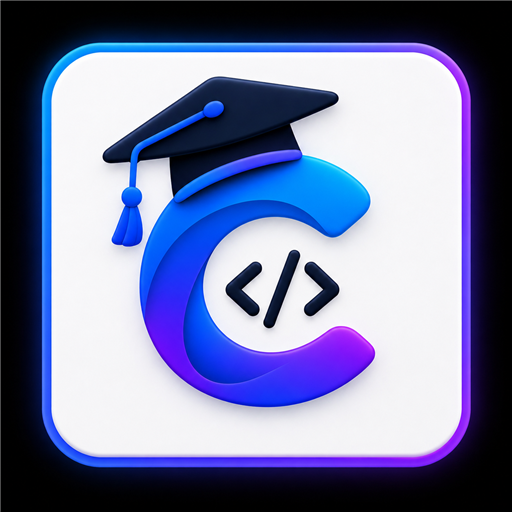

  

<h1 align="center">Codenixa</h1>

  <b>16 focused tools in one Android app</b> 
  for engineering and diploma students.

  
  
  

---

> **This is a presentation repository.** It contains product information, approved branding
> assets and links only. Application source code is private and is not published here.

---

## What Codenixa does

Codenixa packs **16 verified tools** into a single Android app so students stop juggling ten
different applications. Every tool on the website mirrors the live app — names, capabilities
and plan access included.

### Tool areas

| Area | What lives there |
| --- | --- |
| **Career & Job Preparation** | Resume scoring, profile optimisation, placement roadmaps |
| **Interview Practice** | Question banks and mock practice for HR and technical rounds |
| **Student & Academic Tools** | Classes, attendance, deadlines, study and focus sessions |
| **Project & Portfolio Tools** | Ideas, estimates and proposals for your next build |
| **Developer & Technical Tools** | Repository analysis, API testing and developer utilities |

### A few of the tools

| Tool | Plan | What it does |
| --- | --- | --- |
| **Resume Score Checker** | Free | Scores your resume against structure and content checks |
| **Study Session Timer** | Free | Pomodoro and countdown focus sessions that work offline |
| **Attendance Calculator** | Free | Tracks class attendance and the classes you still need |
| **QR Code Generator** | Free | Create and scan QR codes entirely on your device |
| **AI Code Doctor** | Premium | Static analysis over your code with previewable fixes |
| **API Testing Studio** | Premium | Real HTTP requests through a secure proxy, with collections |

---

## The official website

**[codenixa.web.app](https://codenixa.web.app)** is the public face of the app:

- **Features** — what the app does and who it is for
- **Tools** — a searchable catalogue with a detail page per tool
- **Download Center** — current release, exact size and Android requirement
- **Pricing** — the app's verified plan definitions, stated honestly
- **Support, FAQ, Changelog** — plus Privacy, Terms and Refund Policy

The site never asks you to pay through an unverified channel, and it states plainly when a
capability is not yet available rather than implying that it is.

---

## Technology

| Layer | Technologies |
| --- | --- |
| **Android app** | Kotlin · Jetpack Compose · Hilt · Gradle (Kotlin DSL) |
| **Website** | Astro · TypeScript · Custom CSS design system · Self-hosted fonts |
| **Backend & data** | Firebase (Auth, Firestore, Hosting) · Cloud Functions |
| **Delivery** | Firebase Hosting with security headers and immutable asset caching |

High-level technology names only — no source code, configuration or credentials are included
in this repository.

---

## Product facts

| | |
| --- | --- |
| **Application ID** | `com.codenixa.app` |
| **Minimum Android** | 8.0 (API 26) |
| **Website** | [codenixa.web.app](https://codenixa.web.app) |
| **Support** | Via the in-app Support page |

---

## 📬 Contact

  
  
  

  © 2026 Codenixa Technology. Product of Codenixa. All rights reserved.

